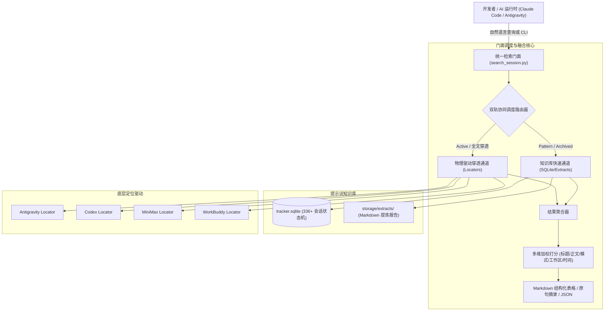

# skill-unified-session-searcher: 统一会话多维检索门面

> **GitHub 仓库公开直链**：https://github.com/JasonCai2024/skill-unified-session-searcher.git  
> 一键克隆命令：
> ```bash
> git clone https://github.com/JasonCai2024/skill-unified-session-searcher.git
> ```

---

## 一、 项目简介与技能定位

`skill-unified-session-searcher` 是面向长期使用多款 AI 编程工具的高级开发者与智能体构建的**一站式会话内容统一检索门面**。

它打破了 Google Antigravity、OpenAI Codex、MiniMax Code 和 Tencent WorkBuddy 四大主流工具之间的物理存储隔离与异构日志格式差异（SQLite / pbtxt / JSONL），并与 `agent-prompt-pattern-extractor` 提炼的会话知识库深度融合。

### 🌟 3 大核心卖点
1. **跨端异质底座大一统**：统一聚合四大 AI 编程工具的底层 Locator 驱动，提供正交、标准、一致的检索语法，告别逐个翻查物理日志。
2. **双轨协同智能调度**：元数据快速通道（毫秒级查询 300+ 归档会话与提示词模式标签）与物理日志深度穿透通道（实时检索活跃开发会话与原始上下文）按需智能路由。
3. **Prompt 模式深度打标联动**：原生支持按 P01~P09 提示词思维模式精确筛选实战案例，直通结构化提炼报告与原始关键对话摘录。

---

## 二、 系统架构与数据流转



---

## 三、 获取与安装配置

### 1. 环境依赖
- **操作系统**：Windows 10/11, macOS, Linux
- **Python 运行时**：Python 3.10+ (仅使用标准库，无需安装任何第三方 pip 依赖)

### 2. 本地部署
```bash
# 进入智能体技能库根目录
cd "E:\BaiduSyncdisk\WorkSpace\ForAgent\SKILLS-编程基础"

# 克隆仓库
git clone https://github.com/JasonCai2024/skill-unified-session-searcher.git

# 进入技能目录
cd skill-unified-session-searcher
```

### 3. 一键健康探活与基准测试
运行内置自检命令，验证跨数据源连通性：
```bash
python scripts/search_session.py --limit 3
```
若控制台正常输出包含不同工具来源的 Markdown 会话表格，说明门面配置完好。

---

## 四、 使用说明与实战指引

### 1. 能做什么与怎么对 AI 助理说 (自然语言 vs CLI 对照)

| 能力名称 | 怎么对 AI 助理说（自然语言触发） | 底层执行命令 / CLI 映射 |
| :--- | :--- | :--- |
| **跨工具关键词排查** | “帮我找一下最近关于‘抖音博主链接解析’的所有会话” | `python scripts/search_session.py -k "抖音博主链接解析"` |
| **提示词模式范式调取** | “我想看看大家是怎么做逆向工程调试的，调取 P07 模式的会话” | `python scripts/search_session.py -p P07 -n 5` |
| **特定工具活跃状态查看** | “查看 Antigravity 当前正在运行或活跃的会话” | `python scripts/search_session.py -t antigravity -s active` |
| **限定特定工作区回溯** | “我在‘社交媒体’工作区都做过哪些会话，搜一下‘图文’” | `python scripts/search_session.py -w "社交媒体" -k "图文"` |
| **相对时间窗精准过滤** | “找一下最近3个月内处理过‘边栏’插件的会话” | `python scripts/search_session.py -k "边栏" --time "最近3个月"` |
| **流水线结构化 JSON 输出** | “以 JSON 格式输出包含 P09 知识沉淀模式的会话” | `python scripts/search_session.py -p P09 --json` |

---

### 2. 典型实战场景工作流

#### 场景 1：疑难故障代码与报错历史溯源
- **背景**：在当前任务中遇到了复杂的流程断裂或第三方 API 报错，记得以往在其他工具（如 Antigravity 或 WorkBuddy）中成功修复过类似问题。
- **操作流程**：
  1. 向 AI 助理输入：“帮我查一下历史上处理过‘抖音数据边栏’获取数据中断的会话”。
  2. 智能体自动执行 `python scripts/search_session.py -k "抖音" -k "边栏"`。
  3. 门面瞬间定位出具体会话（如 `antigravity_43798356`），呈现当时的错误现象与关键上下文原句。
  4. 点击提炼报告链接，直接复用已验证的解决方案。

#### 场景 2：提示词思维进阶与最佳实践复盘
- **背景**：编写复杂系统架构的提示词时，希望参考以往最成功的大型模块开发模式（P01 靶向上下文注入 或 P04 结构化契约驱动）。
- **操作流程**：
  1. 向 AI 助理输入：“调出 3 个体现 P04 契约驱动模式的经典会话案例”。
  2. 智能体运行 `python scripts/search_session.py -p P04 -n 3`。
  3. 门面列出高匹配度会话列表，展示当时开发者提交的原始提示词片段与提炼报告。

---

## 五、 凭证安全与隔离规范

- **零数据上云与纯本地执行**：本技能完全在开发者本地文件系统与 SQLite 数据库中离线运行，严禁、亦无需将任何会话内容或路径上传到任何公网服务器。
- **严格只读保护**：所有底层 SQLite 数据库连接强制采用只读方式打开（`mode=ro` 或受限 `SELECT` 查询），确保不会意外篡改或删除任何原始工程日志。
- **环境变量配置隔离**：提供 `.env.example` 文件，若需要重定向自定义数据源存储路径，可通过本地 `.env` 覆盖，且 `.env` 已加入 `.gitignore` 彻底防泄漏。

---

## 六、 文件目录结构与核心设计决策

```text
skill-unified-session-searcher/
├─ SKILL.md                  # Claude Code / SkillHub 标准技能元数据与工作说明书
├─ README.md                 # 仓库主说明文档（包含 7 大核心要素）
├─ CHANGELOG.md              # 版本演进记录
├─ .env.example              # 环境变量配置模版
├─ .gitignore                # Git 忽略文件（防护本地缓存与环境）
├─ scripts/
│  └─ search_session.py      # 统一检索高层门面入口引擎 (自包含标准库实现)
└─ references/
   ├─ architecture.md        # 三层系统架构设计与双轨路由机制文档
   └─ query_syntax.md        # CLI 查询语法规格、模式代码对照与 JSON 规范
```

### 核心技术决策：
1. **纯 Python 标准库实现**：不引入 `pandas`、`sqlalchemy` 等重型依赖，开箱即用，冷启动延迟低于 100 毫秒。
2. **三层 Facade 模式**：门面统一对外暴露简明参数，底层 Locator 负责物理协议对接，知识库负责高维抽象，各司其职，升级扩展互不影响。
3. **加权打分与多模态展现**：综合标题、对话摘录、模式标签、工作区相关度进行智能重排，同时兼顾 Markdown 人类可读性与 JSON 机器集成性。
