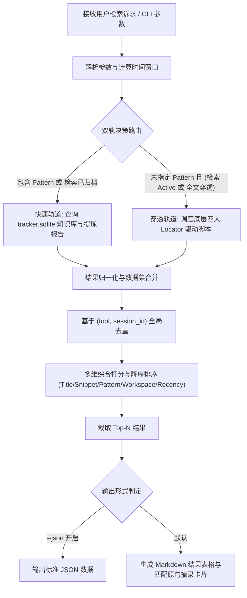

# 统一会话多维检索门面 (Unified Session Searcher)

## Goal

本技能提供统一的高层门面接口（Facade），打破 Google Antigravity、OpenAI Codex、MiniMax Code 和 Tencent WorkBuddy 四大主流 AI 编程工具之间的物理存储隔离与异构日志格式差异。聚合底层各工具专用 Locator 驱动器以及 `agent-prompt-pattern-extractor` 提炼的会话知识库，实现跨工具、跨工作区、跨状态（活跃/已归档）、跨时间窗以及跨提示词思维模式（P01-P09）的毫秒级全文复合检索与知识溯源。

---

## Required Inputs

本技能通过调用 `scripts/search_session.py` 执行，支持以下维度的输入参数（所有参数均为可选，支持任意正交组合）：

1. **`--keyword` / `-k`** (`string`)：全文检索关键词、代码片段、功能名称或特定异常报错信息。
2. **`--pattern` / `-p`** (`string`)：提示词思维模式代码，可选 `P01` 至 `P09`。
3. **`--tool` / `-t`** (`enum`)：限定工具过滤，可选 `all`（默认）、`antigravity`、`codex`、`minimax`、`workbuddy`、`dsh`、`qoder`。
4. **`--status` / `-s`** (`enum`)：会话生命周期状态，可选 `all`（默认）、`active`（开发中活跃会话）、`archived`（已归档会话）。
5. **`--workspace` / `-w`** (`string`)：工作区绝对路径或项目标识片段（如 `"ForAgent"`, `"社交媒体"`）。
6. **`--time`** (`string`)：自然语言相对时间窗（如 `"today"`, `"yesterday"`, `"最近3天"`, `"最近3个月"`）。
7. **`--after` / `--before`** (`string`)：标准日期范围，格式为 `YYYY-MM-DD`。
8. **`--limit` / `-n`** (`int`)：最大返回记录数，默认 `10`。
9. **`--json`** (`flag`)：输出结构化 JSON，便于自动化流水线解析。

---

## Workflow



### 执行步骤说明：

1. **意图解析与参数规范化**：
   - 解析用户指令，提取关键词、工具倾向、时间要求与模式意图；
   - 若用户输入自然语言时间（如“最近3个月”），自动转换为标准 ISO 日期起止区间。
2. **双轨协同检索路由**：
   - **元数据与模式快轨**：当查询涉及模式标签（`--pattern`）或已归档会话时，优先通过 `agent-prompt-pattern-extractor` 的 `tracker.sqlite` 数据库与 `storage/extracts/` 提炼报告进行秒级检索，直接提取结构化打标数据；
   - **物理驱动深穿轨**：当用户检索当前活跃会话（`--status active`）或需要穿透未提炼的原始会话全文时，并发调度四大底层 Locator 驱动脚本。
3. **数据清洗、去重与打分**：
   - 以 `(tool, session_id)` 为唯一主键消除重复结果，合并两轨的补充字段；
   - 根据标题匹配度（+50）、正文原句匹配度（+30）、模式精准度（+40）、工作区一致性（+20）与时间衰减（0~10）计算综合分值并降序排列。
4. **渲染结构化交付物**：
   - 默认输出易读的 Markdown 矩阵表格，包含工具名、状态、标题、工作区、时间及模式标签；
   - 对命中上下文的会话附带展示关键原句摘录与提炼报告超链接。

---

## Decision Rules

1. **模式查询隔离规则**：
   - 若用户传入 `--pattern`，底层各工具的原始 Locator 不支持模式过滤，**严禁**盲目调用底层 Locator 导致结果污染；必须且仅调度 `tracker.sqlite` 知识库链路。
2. **只读访问绝对红线**：
   - 严禁对任何底层 SQLite 数据库（`tracker.sqlite`, `runtime-state.sqlite`, `workbuddy.db`）执行写入或删除；连接参数必须显式声明为只读模式或只执行 `SELECT` 语句。
3. **零硬编码与容错降级**：
   - 各工具的定位脚本若因环境缺少依赖或目录不存在导致执行失败，门面必须安全捕获异常，记录告警日志，但不可中断整体检索，应平滑返回其他健康数据源的匹配结果。
4. **长文本防爆截断**：
   - 原文摘录每个命中文档最多截取前 2 条代表性原句，每句长度限制在 120 字符以内，防止过长输出挤占上下文。

---

## Output Requirements

### 1. 标准 Markdown 终端输出格式
必须包含：
- **结果统计摘要**：命中记录总数；
- **全景对齐表格**：包含列 `#`、`工具类型`、`状态`、`会话标题 / 标识`、`关联工作区`、`时间`、`提示词模式`；
- **关键上下文原句摘录卡片**（如有正文命中）：清晰标明工具名称、会话标题、原句引用与提炼报告相对路径链接。

### 2. 结构化 JSON 输出格式（`--json`）
包含顶层对象：
- `query`：请求参数镜像；
- `total`：命中总数；
- `results`：会话对象数组（含 `tool`, `session_id`, `title`, `status`, `workspace`, `timestamp`, `matched_snippets`, `report_path`, `patterns`）。

---

## Validation

在执行或扩展本技能后，按以下测试集进行验证：
1. **关键词联合检索验证**：
   ```bash
   python scripts/search_session.py --keyword "边栏" --limit 3
   ```
   *预期*：返回包含“边栏”关键词的历史会话，且表格与原句摘录格式正确。
2. **模式标签过滤验证**：
   ```bash
   python scripts/search_session.py --pattern P07 --limit 5
   ```
   *预期*：返回命中 P07（逆向工程模式）的会话，模式列明确显示 `P07`，不触发底层原始 locator。
3. **活跃状态过滤验证**：
   ```bash
   python scripts/search_session.py --status active --limit 3
   ```
   *预期*：返回当前正在运行或未归档的会话，状态列标为 `活跃`。
4. **JSON 结构化输出验证**：
   ```bash
   python scripts/search_session.py --keyword "抖音" --json
   ```
   *预期*：输出合法 JSON，无多余终端日志污染标准输出。

---

## Fallback

1. **知识库未找到匹配项**：
   - 若在 `tracker.sqlite` 中未检索到关键词，门面自动向下穿透调度各工具物理 Locator 脚本对原始日志进行兜底全文扫描。
2. **底层定位器脚本不可用**：
   - 若某底层工具未安装或其 Locator 脚本路径无效，门面自动跳过该驱动器并在结果末尾标注降级提示，保留其他工具与已提取知识库的检索结果。
3. **无任何匹配记录**：
   - 输出友好的未命中提示，列出已检索的数据源范围，并建议用户调整关键词或扩大时间范围。

---

## Examples

### 示例 1：排查历史疑难 Bug 会话
- **输入话术**：“帮我找一下之前处理过‘抖音博主链接解析’相关报错的 Antigravity 会话”
- **执行命令**：
  ```bash
  python scripts/search_session.py -t antigravity -k "抖音博主链接解析"
  ```

### 示例 2：复盘特定提示词思维模式
- **输入话术**：“我想学习一下高难度的逆向排错，调取所有符合 P07 逆向工程模式的会话”
- **执行命令**：
  ```bash
  python scripts/search_session.py -p P07 -n 5
  ```

### 示例 3：工作区近况多工具巡检
- **输入话术**：“看一下最近在‘ForAgent’工作区下的所有会话，不管哪个工具”
- **执行命令**：
  ```bash
  python scripts/search_session.py -w "ForAgent" --limit 10
  ```
