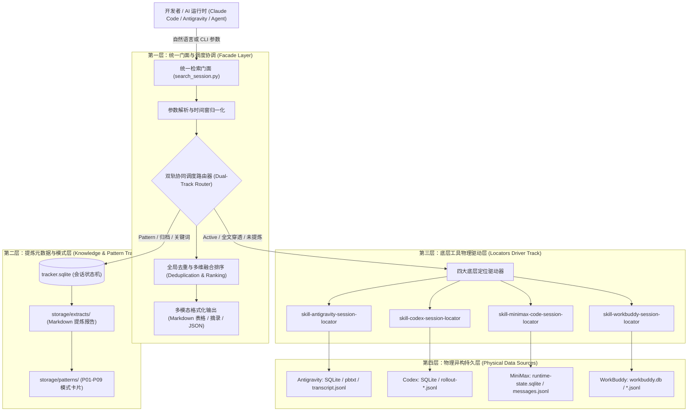

# 统一会话检索门面架构设计 (Unified Session Searcher Architecture)

## 一、 系统定位与设计哲学

在长期的 AI 辅助软件开发实践中，开发者往往同时使用多款主流 AI 编程工具（Google Antigravity、OpenAI Codex、MiniMax Code、Tencent WorkBuddy）。这些工具各自采用异构的日志存储机制（SQLite、pbtxt、JSONL、LevelDB 等）。

随着 `agent-prompt-pattern-extractor` 对数以百计的历史会话进行结构化提炼，形成了丰富的提示词模式（P01-P09）与元数据资产。然而，开发者与智能体在日常开发中面临两类割裂的检索诉求：
1. **原始会话排查**：某个报错在哪个会话解决过？某段代码逻辑在哪个工作区讨论过？
2. **模式范式复用**：哪些历史会话展现了“P07 逆向工程与深层调试”或“P01 靶向上下文注入”的高质量提示词？

`skill-unified-session-searcher` 采用 **Facade（外观）设计模式**，作为跨四大工具驱动与提示词知识库的统一入口，屏蔽底层协议差异，提供双轨自适应路由与多维复合检索能力。

---

## 二、 三层系统分层架构

---

## 三、 双轨协同调度机制 (Dual-Track Routing)

检索门面根据用户输入的查询条件自动决策数据源路径，实现毫秒级快速响应与底层深穿透的平衡：

### 1. 快速轨道（Knowledge & Metadata Track）
- **触发条件**：
  - 用户指定了 `--pattern`（如 `P01`, `P07`）。
  - 用户查询已归档会话（`--status archived` 或默认 `--status all`）。
- **查询目标**：
  - `agent-prompt-pattern-extractor/storage/tracker.sqlite`。
  - `agent-prompt-pattern-extractor/storage/extracts/YYYY-MM/*.md`。
- **核心优势**：
  - 元数据预先抽取并索引，单次 SQL 查询即可覆盖 300+ 归档会话。
  - 自动挂载各会话关联的提示词模式标签（如 `P01`, `P03`, `P07`）与提炼报告相对路径。

### 2. 深度穿透轨道（Driver & Full-Text Track）
- **触发条件**：
  - 用户显式指定 `--status active`（活跃开发中会话）。
  - 未指定 pattern 且需要检索最新的未提炼原始日志全文。
  - 知识库快速轨道未命中匹配结果时自动回退。
- **查询目标**：
  - 并发或按需调用底层四大 locator 技能脚本。
- **核心优势**：
  - 穿透到各工具的物理会话文件与最近生成的增量消息。
  - 确保活跃会话的零滞后实时可查。

---

## 四、 结果融合、去重与打分排序策略

由于双轨调度可能返回相同会话的记录（例如知识库中已记录，物理驱动也扫描到了），门面执行统一的归一化与权重打分：

### 1. 唯一性去重标准
- 联合键：`unique_key = f"{tool}:{session_id}"`。
- 合并原则：保留更完整的字段（优先保留模式标签与提炼报告链接，物理驱动提供最新活跃时间和原生匹配摘录）。

### 2. 启发式评分模型
每个命中的会话计算匹配分值：
$$\text{Score} = S_{\text{title}} + S_{\text{content}} + S_{\text{pattern}} + S_{\text{workspace}} + S_{\text{recency}}$$

| 打分项 | 触发条件 | 分值权重 |
| :--- | :--- | :---: |
| $S_{\text{title}}$ | 会话标题直接包含关键词 | **+50** |
| $S_{\text{content}}$ | 对话原句或摘录包含关键词 | **+30** |
| $S_{\text{pattern}}$ | 精准匹配目标模式代码 (如 P07) | **+40** |
| $S_{\text{workspace}}$ | 关联工作区名称命中检索词 | **+20** |
| $S_{\text{recency}}$ | 时间衰减加分（越近的会话分值越高） | **0 ~ 10** |

最终按综合得分降序截取 `--limit` 条目输出。

---

## 五、 模块接口与依赖解耦

本门面采用“轻耦合、自包含”的原则构建：
1. **零外部重依赖**：仅使用 Python 标准库（`argparse`、`sqlite3`、`pathlib`、`json`、`subprocess`、`datetime`、`re`）。
2. **渐进式降级**：
   - 若底层某工具的 Locator 脚本未就绪或报错，自动捕获异常并降级，不阻塞其他工具的检索。
   - 若 `tracker.sqlite` 数据库正在写入锁定，自动以共享读模式只读访问。
3. **安全只读保障**：所有查询连接强制开启 `file:...mode=ro` 或原生只读模式，严禁对任何底层数据源执行修改或写入操作。
